<p align="center">
<a href="https://modrinth.com/mod/total-storage"></a>
<a href="https://github.com/grabartley/minecraft-total-storage/stargazers"></a>
<a href="LICENSE"></a>
<a href="https://ko-fi.com/grahambartley"></a>
</p>

<p align="center">
<a title="Fabric API" href="https://modrinth.com/mod/fabric-api" target="_blank">
	
</a>
</p>

# Total Storage

Total Storage turns a room full of chests into one searchable inventory. Place a storage terminal near your chests,
power it with redstone, and everything inside them is one screen away. Search it, take what you need, and empty your
pockets into it with one click. A sort button on every container and a lock for your hotbar come along too, and those
work with no terminal at all.

> **Alpha:** Total Storage is in alpha and we would love your feedback.
> [Open an issue](https://github.com/grabartley/minecraft-total-storage/issues/new) and tell us what you think.

<p align="center">
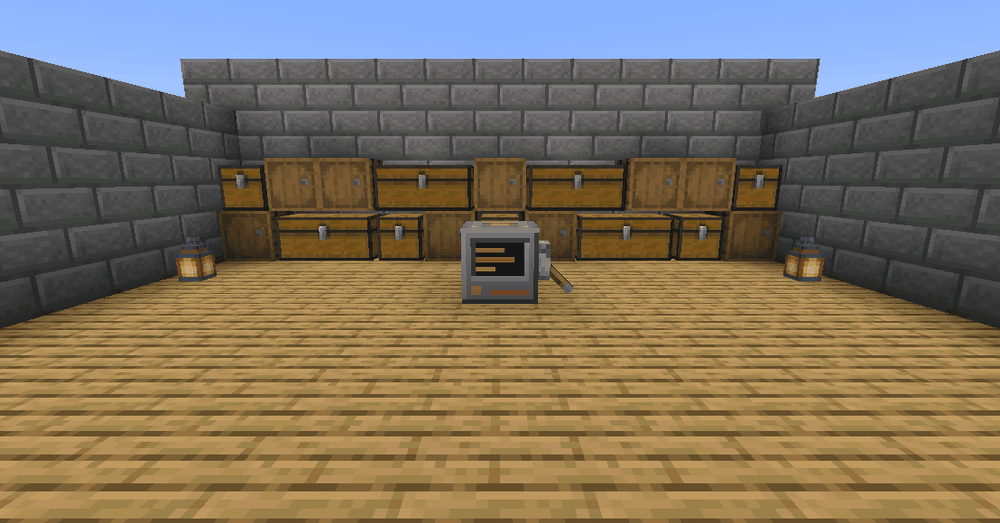
</p>

## The storage terminal

Craft a terminal, put it near your chests, and power it. A lever on its side or top will do, just keep the front
clear, since that is its screen. Every chest, barrel and
shulker box within 16 blocks joins the network, and the terminal outlines them so you can see what it reaches. Drop a
new chest in range and it joins on its own. Cut the power and the terminal goes dark, but it remembers everything you
set up.

<p align="center">
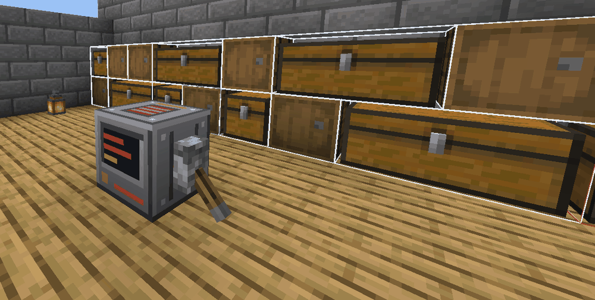
</p>

Right-click the terminal and the whole network is on one screen, above your own inventory.

<p align="center">
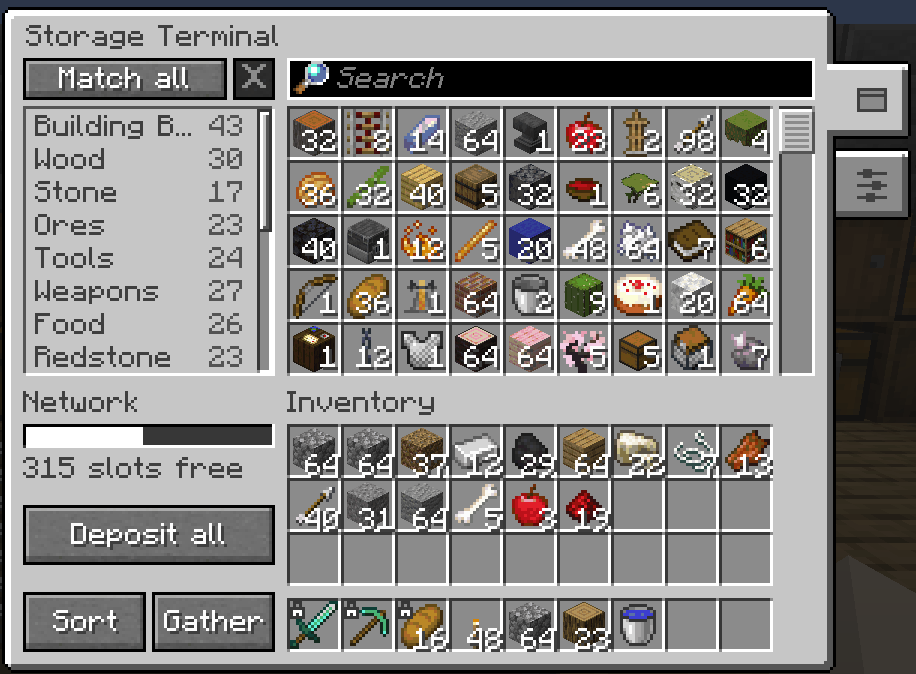
</p>

## What you can do

- **Find anything.** The search box is ready the moment the screen opens. Type a few letters and the closest matches
come first, so `dch` finds a Dark Oak Chest. `#tag` searches by tag and `@mod` narrows to one mod, and both mix with
plain text, so `@create gear` finds the gears Create adds.

<p align="center">
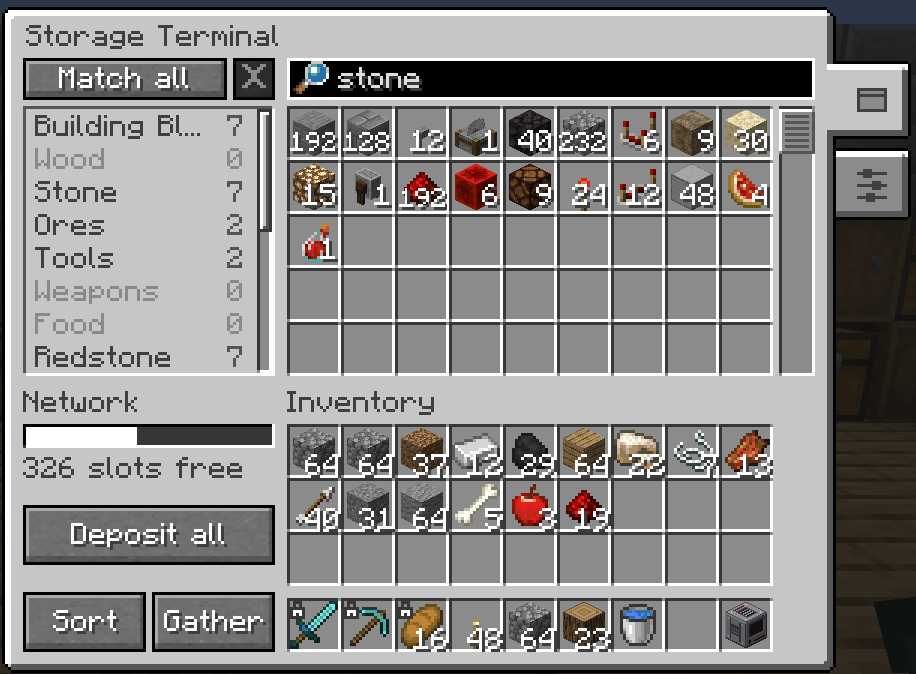
</p>

- **Take what you need.** Left-click a cell for a stack, right-click for half, shift-click to send it straight to your
inventory, and middle-click to type an exact amount. With something on your cursor, left-click to put it all in and
right-click to put in one.
- **Empty your pockets.** Press Deposit all, or `R`, and your inventory goes into the network with each item routed to
the chest it belongs in. Locked slots, armour and your offhand stay put. The bar on the left shows how full the network
is and warns you before it runs out of room.

<p align="center">
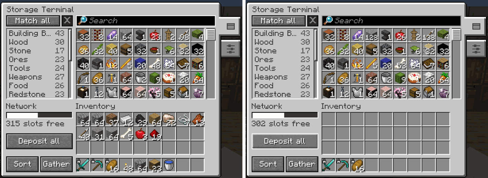
</p>

- **Browse by tag.** Every item already sits in a category like Tools, Food or Redstone. Click a tag to narrow the grid
to it, pick several and choose whether an item needs all of them or any of them. Tags and the search box work together,
so `castle` plus the Stone tag finds the stone you filed under Castle.

<p align="center">
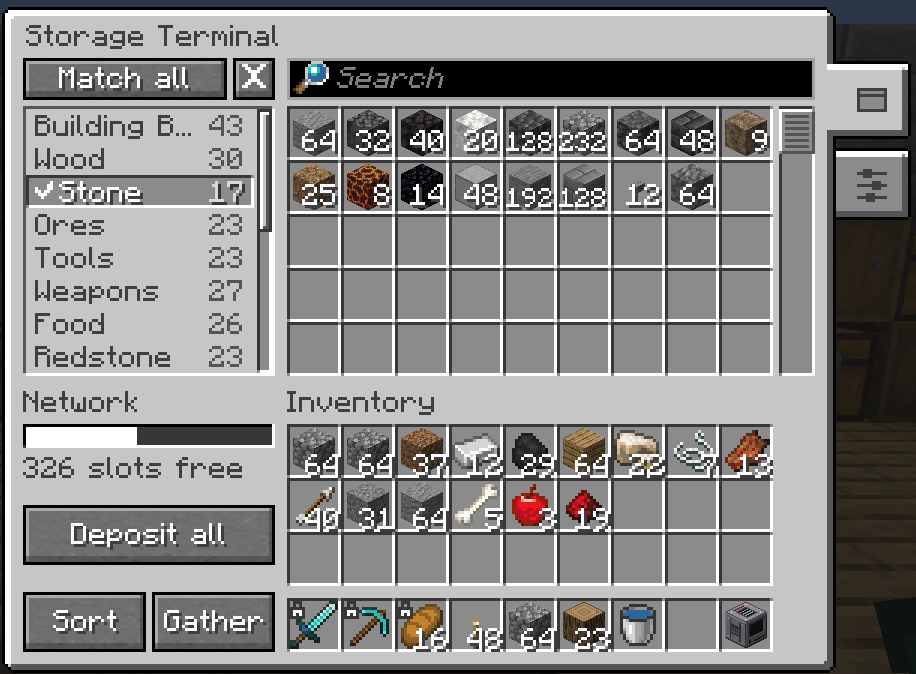
</p>

- **Make your own tags.** Base Kit, Castle, Nether Trip: whatever your world needs. Ctrl-click an item (Cmd on a Mac)
to file it, or shift-click a tag to file everything the grid is showing at once. Tags can be copied to your other
terminals.

<p align="center">
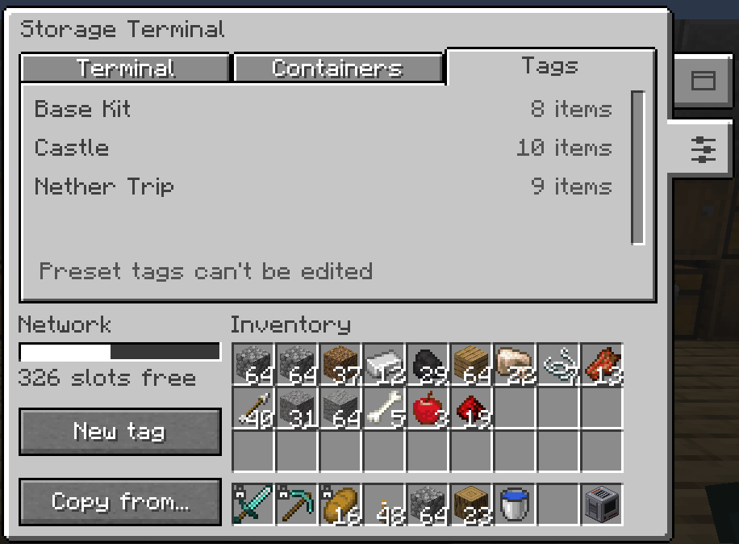
</p>

- **Decide what the network may touch.** Each container has a role. **General** takes anything. **Filtered** only takes
the tags you tick. **Excluded** is searchable but never written to, so your hand-arranged potion chest stays exactly as
you left it. Give containers names so the list says Potions instead of coordinates, and press Show in world to outline
them: white for General, green for Filtered, red for Excluded.

<p align="center">
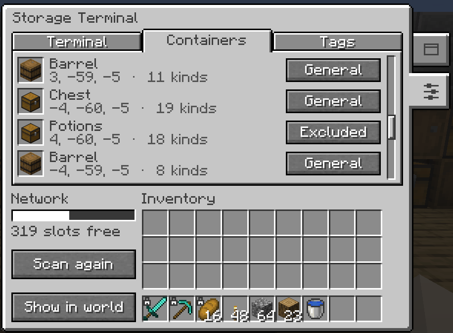
</p>

<p align="center">
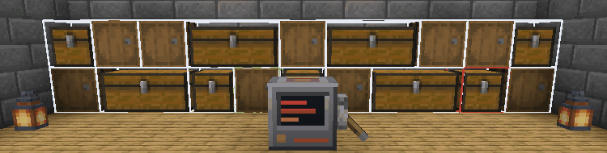
</p>

- **Keep the chests tidy.** Sort orders every chest in the network and Gather pulls each item into as few chests as
possible, so opening a chest by hand still makes sense. Big jobs ask before they start, run in the background without
lagging the server, and can be stopped part way.
- **Sort anything, anywhere.** A sort button sits on every chest, barrel and shulker box screen and on your inventory,
and it works on modded containers too. Press `B` to sort without the mouse, or use `/ts sort`.

<p align="center">
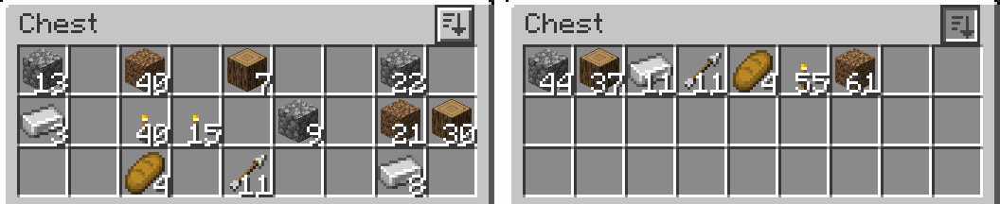
</p>

- **Quick stack.** The other button on your inventory tops up matching stacks in the containers around you and leaves
everything else alone. `V` does the same.

<p align="center">
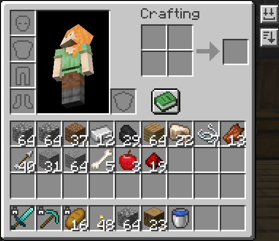
</p>

- **Lock your hotbar.** Alt-click a slot and nothing automated will ever move what is in it: not sorting, not Deposit
all, not quick stack. You can still move it yourself. Hold Alt in any inventory screen to see which slots can be locked.
- **Share safely.** A terminal opens only for the player who placed it until they say otherwise. Switch it to Trusted
and add friends by name, or set it to Open for everyone. Operators can always get in, and the server logs when they do.

<p align="center">
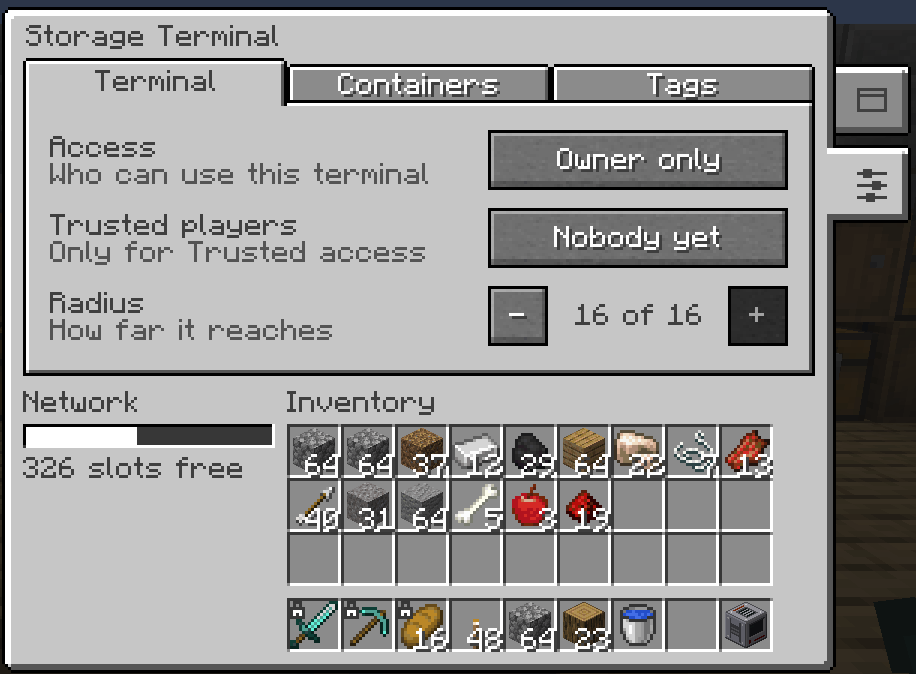
</p>

## Install

1. Install Fabric Loader, then put Total Storage and [Fabric API](https://modrinth.com/mod/fabric-api) in your `mods`
folder. The mod has to be on the server and on every player's game. A player without it is told so at login.
2. Craft a terminal from a chest, four iron ingots, three redstone dust and one ender pearl.

<p align="center">
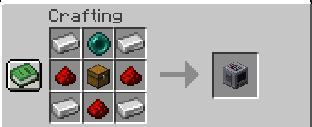
</p>

3. Place it near your chests, power it, and right-click it.

The keys are `R` for Deposit all, `V` for quick stack and `B` for sort. Change them under `Options > Controls > Key
Binds`, in the Total Storage section.

## Settings

Open server settings from Mod Menu, or with `/ts config`. In singleplayer you can change them. On a server, only
operators can, and everyone else can read them. Each terminal keeps its own radius, access and roles on the block, set
from its Settings tab.

<details>
<summary><b>All server settings</b></summary>

Settings are saved per world. A value out of range is clamped when the file loads and refused by the command.

| Setting | Default | Range | What it does |
|---|---|---|---|
| Maximum terminal radius | 16 | 1 to 64 | The furthest any terminal may reach. Lowering it pulls in terminals that are already running; raising it gives their reach back. |
| Default access mode | Owner | Owner, Trusted, Open | What a newly placed terminal starts as. Terminals already placed keep theirs. |
| Quick stack radius | 8 | 1 to 64 | How far quick stack looks for containers to top up. |
| Sort ordering | Registry id | Registry id, Display name | How sorted containers are ordered. Registry id does not change with the game language. |
| Sort button | On | On or off | Whether the sort button and key are offered. `/ts sort` keeps working either way. |
| Quick stack | On | On or off | Whether quick stack is offered on the button, the key and the command. |
| Deposit all skips the hotbar | Off | On or off | Keeps the whole hotbar out of Deposit all, for players who would rather not lock slots. |
| Near capacity warning | 90% | 0 to 100 | How full the network has to be before the terminal warns you. |
| Expensive operation cooldown | 10 ticks | 0 to 200 | Per player wait between rescans, deposits, quick stacks, sorts and gathers. 0 turns it off. Raise this first on a busy server. |
| Moves per tick budget | 64 | 1 to 1024 | How much one network-wide sort or gather may do per tick. Lower is smoother and slower. |
| Ask above this many containers | 8 | 0 to 1024 | A sort or gather touching more containers than this asks before it starts. 0 never asks. |

`/ts config eligibility` forces a block into or out of every network, which is how you admit a modded container the mod
does not recognise, or keep one out. Furnaces, hoppers, brewing stands and ender chests are left out by default.

The locked slot badge is always drawn. A tint behind locked slots is off by default and can be switched on in
`config/total-storage/client.json` in your game folder.

</details>

<details>
<summary><b>Commands</b></summary>

`/totalstorage` and `/ts` are the same. `/ts` on its own lists them. Terminal commands take the terminal's block
position, and container commands take the container's.

```
/ts config list
/ts config get <setting>
/ts config set <setting> <value>
/ts config reset <setting>
/ts config reset all
/ts config eligibility list
/ts config eligibility set <block> <true|false>
/ts config eligibility clear <block>
/ts config eligibility clear all
/ts terminal <pos> info
/ts terminal <pos> radius [blocks]
/ts terminal <pos> access [owner|trusted|open]
/ts terminal <pos> trust [players]
/ts terminal <pos> untrust <players>
/ts terminal <pos> role <container> [general|filtered|excluded]
/ts terminal <pos> name <container> [set <name>|clear]
/ts terminal <pos> filter <container> [add <tag>|remove <tag>|clear]
/ts terminal <pos> rescan
/ts terminal <pos> highlight
/ts terminal <pos> tags export <file>
/ts terminal <pos> tags import <file> <merge|replace>
/ts terminal <pos> tags copy <pos> <merge|replace>
/ts sort
/ts quickstack
```

Anyone can read a setting, sort what they have open or are looking at, and quick stack. Changing a server setting
needs operator permission. Changing a terminal needs its owner or an operator. Settings and values tab-complete, and
changes apply at once.

</details>

<details>
<summary><b>Works well with</b></summary>

None of these are needed.

- **[Mod Menu](https://modrinth.com/mod/modmenu)** adds the server settings screen to your mods list.
- **[JEI](https://modrinth.com/mod/jei)** and **[EMI](https://modrinth.com/mod/emi)** show the terminal recipe.

</details>

<details>
<summary><b>Requirements</b></summary>

Minecraft `1.21.1` on Java `21`.

| Mod           | Version              |
|---------------|----------------------|
| Fabric Loader | `>=0.16.5`           |
| Fabric API    | `>=0.116.12+1.21.1`  |

</details>

## Languages

Total Storage is in English. Want to add your language? Copy
[`en_us.json`](src/main/resources/assets/total-storage/lang/en_us.json), translate the text, and open a pull request.
Keep the keys and the `%s` placeholders as they are, and leave command names and arguments untranslated.

## Credits

How every part of the mod is meant to work is written down in the [product requirements](docs/prd.md).

Total Storage is made by Vitória Vedana and Graham Bartley and released under the [MIT License](LICENSE).

If you enjoy Total Storage, a star on GitHub or a coffee on Ko-fi helps a lot.

<a href="https://ko-fi.com/grahambartley" rel="noopener nofollow ugc" target="_blank">

</a>
