<p align="center">
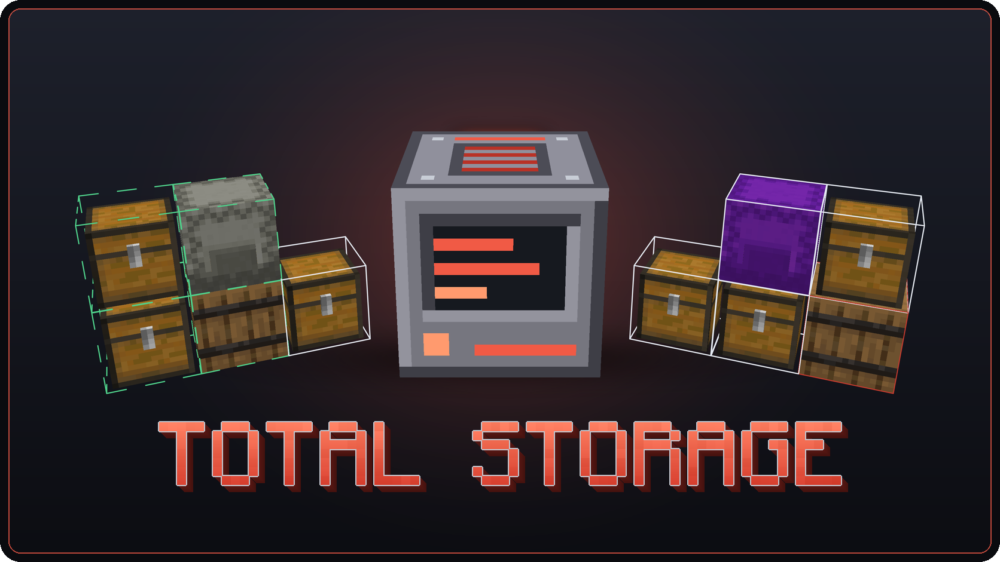
</p>

<p align="center">
<a href="https://modrinth.com/mod/total-storage"></a>
<a href="https://github.com/grabartley/minecraft-total-storage/stargazers"></a>
<a href="https://github.com/grabartley/minecraft-total-storage/blob/main/LICENSE"></a>
<a href="https://ko-fi.com/grahambartley"></a>
</p>

<p align="center">
<a title="Fabric API" href="https://modrinth.com/mod/fabric-api" target="_blank">

</a>
</p>

# Total Storage

Total Storage turns a room full of chests into one searchable inventory. Place a terminal near your chests, power it,
and reach everything in them from one screen.

> **Alpha:** Total Storage is in alpha and we would love your feedback.
> [Open an issue](https://github.com/grabartley/minecraft-total-storage/issues/new) and tell us what you think.

<p align="center">
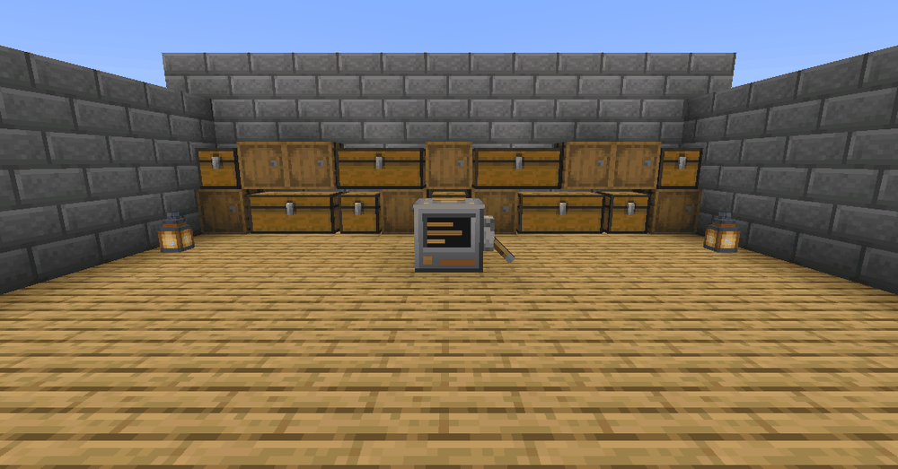
</p>

## One terminal for every chest

<p align="center">
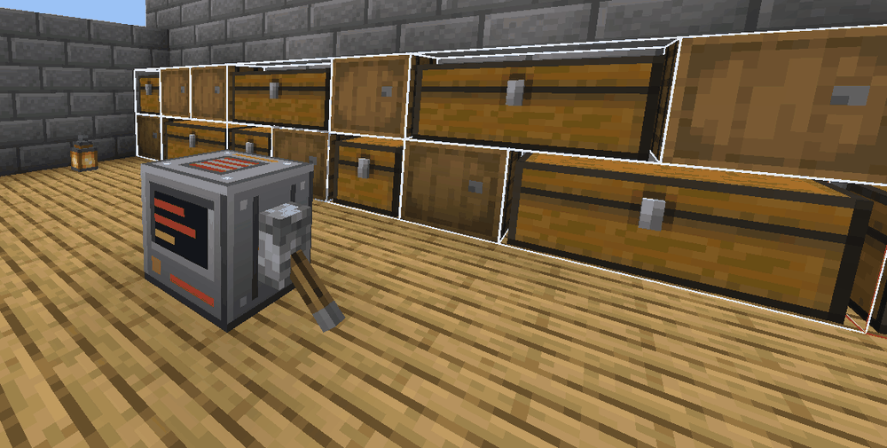
</p>

- **Build the network.** Put a terminal near your chests and power it. A lever on any side works, but keep the front
clear: that is its screen. Every chest, barrel and shulker box within 16 blocks in every direction joins, and a new
chest placed in range joins on its own. You can change the reach per terminal.
- **See what it reaches.** When it powers on, the terminal outlines every container in its network. Cut the power and it goes dark, but it
remembers everything you set up.
- **Open it.** Right-click it and the whole network is in front of you, above your own inventory.
- **Share safely.** A terminal opens only for the player who placed it until they say otherwise. Let in trusted players
by name, or anyone at all. Operators can always get in, and the server logs when they do.

<p align="center">
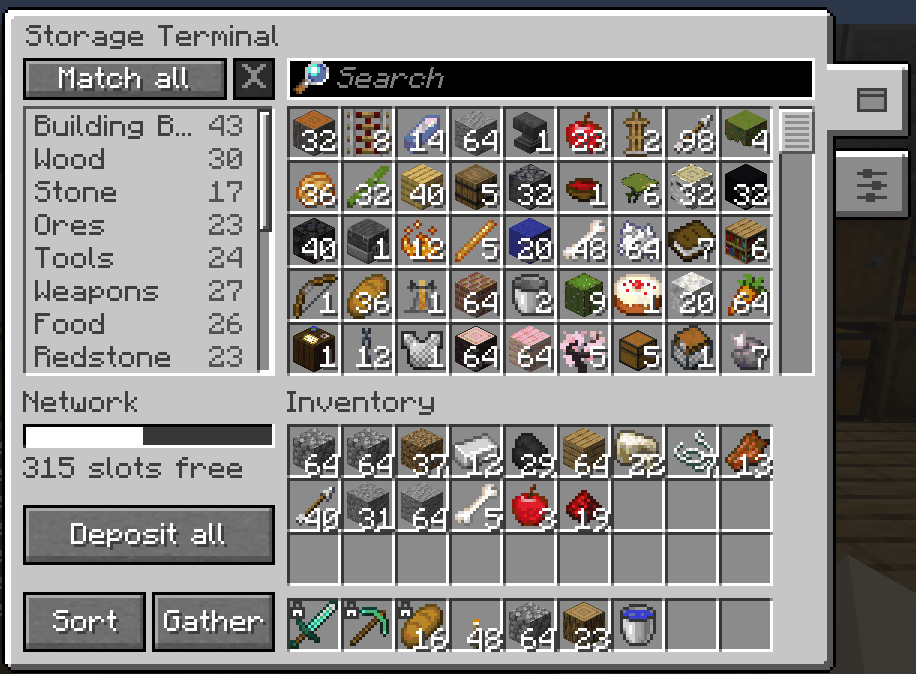
</p>

## Find anything

<p align="center">
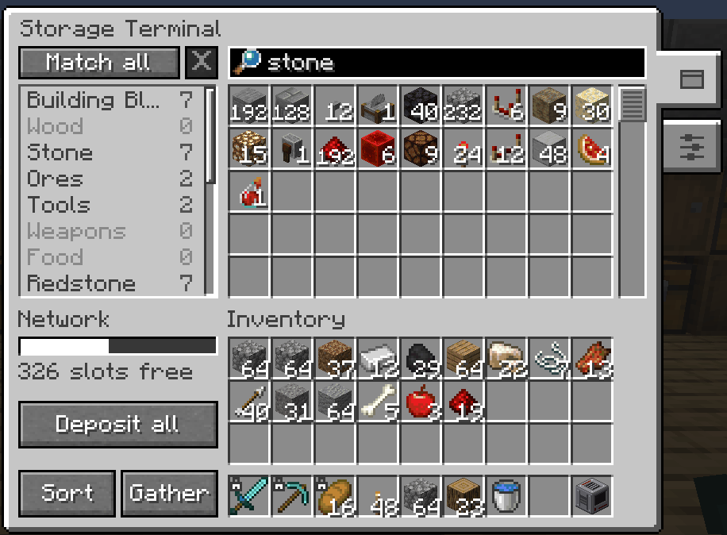
</p>

- **Search.** The search box is ready the moment the screen opens. Type part of a name and the closest matches come
first. Turn on fuzzy search with the `~` button and `dpick` finds a Diamond Pickaxe. `#tag` searches by tag and
`@mod` narrows to one mod, so `@create cog` finds the cogwheels Create adds.
- **Browse by tag.** Every item already sits in a category like Tools, Food or Redstone. Click a tag to narrow the grid,
pick several, and choose whether an item needs all of them or any of them.
- **Make your own tags.** Press New tag on the Tags tab to make tags such as Base Kit or Castle for your own world. Ctrl-click an item (Cmd on a Mac) to
file it, or shift-click a tag to file everything the grid is showing. Tags can be copied from your other terminals.
- **Take what you need.** Left-click for a stack, right-click for half, shift-click to send it to your inventory, and
middle-click to type an exact amount.

<p align="center">
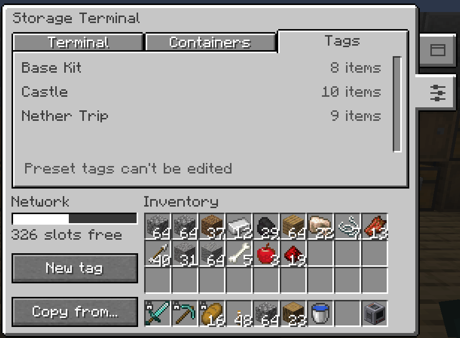
</p>

## Put it all away

<p align="center">
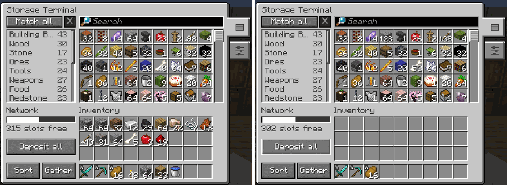
</p>

- **Empty your pockets.** Press Deposit all and your inventory goes into the network, each item to the chest it belongs
in. Something the network has never held starts an empty chest instead of mixing in. Locked slots, armour and your
offhand stay put. A bar shows how full the network is and warns you before it runs out of room.
- **Decide what the network may touch.** A General container takes anything. A Filtered one only takes the tags you
tick. An Excluded one can be searched and taken from, but the network never puts items in it or rearranges it, so your
hand-arranged potion chest keeps its layout. Name your containers and outline them in the world by role.
- **Keep the chests tidy.** Sort orders every chest in the network and Gather pulls each item into as few chests as
possible, so opening a chest by hand still makes sense. Big jobs ask first, run in the background without lagging the
server, and can be stopped part way.

<p align="center">
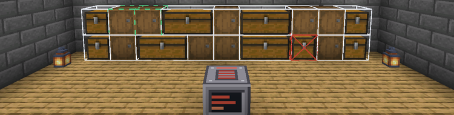
</p>

## Tidy without a terminal

<p align="center">
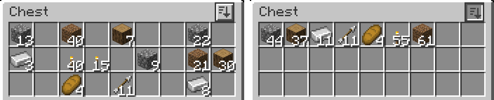
</p>

- **Sort anything.** A sort button sits on every chest, barrel and shulker box screen and on your inventory, and it
works on modded containers too.
- **Quick stack.** The button beside sort on your inventory tops up matching stacks in the containers around you and
leaves everything else alone.
- **Lock slots.** Alt-click (Option on a Mac) any inventory slot and sorting, Deposit all and quick stack leave it
alone. Locked slots show a small padlock in the terminal. Hold Alt in any inventory to see which slots can be locked.

<p align="center">
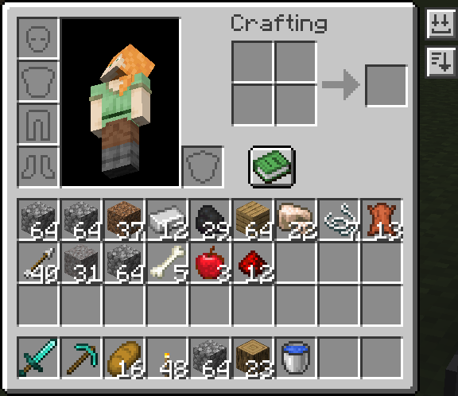
</p>

## Install

1. Install [Fabric Loader](https://fabricmc.net/use/), then put Total Storage and
[Fabric API](https://modrinth.com/mod/fabric-api) in your `mods` folder.
2. Craft a terminal from a chest, four iron ingots, three redstone dust and one ender pearl.

<p align="center">
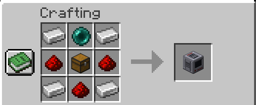
</p>

3. Place it near your chests, power it, and right-click it.

Total Storage works in singleplayer and on servers, on Minecraft `1.21.1`. On a server it has to be on the server and
on every player's game, and a player without it is told to install it. Its keys are under
`Options > Controls > Key Binds`, in the Total Storage section: `R` deposits all, `V` quick stacks and `B` sorts.

## Settings

Server settings cover everything from how far a terminal may reach to how big a job has to be before it asks first.
Change them on the settings screen in Mod Menu, or with `/ts config`. In singleplayer you can change them. On a server,
only operators can. Each terminal keeps its own reach, access, container roles and tags on the sliders tab of its
screen. If the mod does not recognise a modded container, you, or an operator on a server, can add it with
`/ts config eligibility`. Your own display options, such as hiding the sort button or tinting locked slots, are on
the same settings screen, and you can change them anywhere, even from the title screen.

<details>
<summary><b>Commands</b></summary>

`/totalstorage` and `/ts` are the same. `/ts` on its own lists them. Terminal commands take the terminal's block
position, and container commands take the container's.

```
/ts config list
/ts config get <setting>
/ts config set <setting> <value>
/ts config reset <setting>
/ts config reset all
/ts config eligibility list
/ts config eligibility set <block> <true|false>
/ts config eligibility clear <block>
/ts config eligibility clear all
/ts terminal <pos> info
/ts terminal <pos> radius [blocks]
/ts terminal <pos> access [owner|trusted|open]
/ts terminal <pos> trust [players]
/ts terminal <pos> untrust <players>
/ts terminal <pos> role <container> [general|filtered|excluded]
/ts terminal <pos> name <container> [set <name>|clear]
/ts terminal <pos> filter <container> [add <tag>|remove <tag>|clear]
/ts terminal <pos> rescan
/ts terminal <pos> highlight
/ts terminal <pos> tags export <file>
/ts terminal <pos> tags import <file> <merge|replace>
/ts terminal <pos> tags copy <from> <merge|replace>
/ts sort
/ts quickstack
```

Anyone can read a setting, sort what they have open or are looking at, and quick stack. Changing a server setting
needs operator permission on a server. Changing a terminal needs its owner or an operator. Settings and values tab-complete, and
changes apply at once. Tag exports and imports use `total-storage/tag-sets/<file>.json` inside the world folder.

</details>

<details>
<summary><b>Works well with</b></summary>

None of these are needed.

- **[Mod Menu](https://modrinth.com/mod/modmenu)** adds the settings screen to your mods list.
- **[JEI](https://modrinth.com/mod/jei)** and **[EMI](https://modrinth.com/mod/emi)** show the terminal recipe.

</details>

<details>
<summary><b>Requirements</b></summary>

Minecraft `1.21.1` on Java `21`.

| Mod           | Version              |
|---------------|----------------------|
| Fabric Loader | `>=0.16.5`           |
| Fabric API    | `>=0.116.12+1.21.1`  |

</details>

## Languages

Total Storage is in English. Want to add your language? Copy
[`en_us.json`](https://github.com/grabartley/minecraft-total-storage/blob/main/src/main/resources/assets/total-storage/lang/en_us.json), translate the text, and open a pull request.
Keep the keys and the `%s` placeholders as they are, and leave command names and arguments untranslated.

## Credits

How every part of the mod is meant to work is written down in the [product requirements](https://github.com/grabartley/minecraft-total-storage/blob/main/docs/prd.md).

Total Storage is made by Vitória Vedana and Graham Bartley and released under the [MIT License](https://github.com/grabartley/minecraft-total-storage/blob/main/LICENSE).

If you enjoy Total Storage, a star on GitHub or a coffee on Ko-fi helps a lot.

<a href="https://ko-fi.com/grahambartley" rel="noopener nofollow ugc" target="_blank">

</a>
